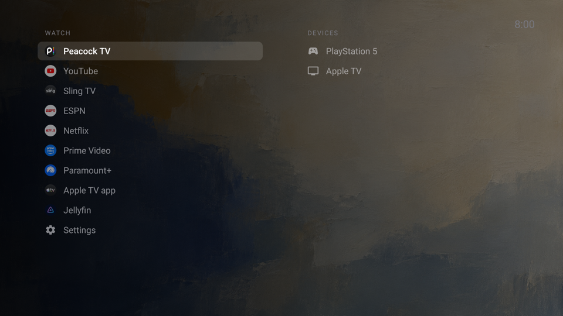

# Quiet Home

A calm, private home screen for Android TV and Google TV. Your streaming apps in one list, your plugged-in devices (PlayStation, Apple TV, …) in another, your own pictures in the background. No ads, no recommendation rows, no internet access.



- **Two plain lists.** Apps on the left, HDMI devices on the right under the names they report ("PlayStation 5"), Settings at the bottom.
- **Most-used first.** Apps and devices you open most move up, re-sorted once a day so nothing jumps while you scroll.
- **Your pictures.** Drop photos in a folder; a new one shows every 30 minutes, darkened so the list stays readable.
- **Private by design.** The app asks for no permissions at all, including internet. Usage counts never leave the TV.
- **Small and boring.** Plain Java, about 1,000 lines plus tests, built with the Android SDK's own tools. No Gradle, no libraries.

It was built with Claude Code driving the TV over adb, and it's meant to be set up the same way: your AI assistant (or you) edits a text file and pushes it to the TV.

> **Status: provided as is.** Built and tested on one Sony BRAVIA (Android TV 12). Other brands will probably need small changes (see [Other TVs](#other-tvs)). Issues and pull requests are welcome, but there's no promise of support.

## How it works

Google TV doesn't let another app become the default home screen. Quiet Home uses an **accessibility service** that notices when Google's home screen comes to the front and opens Quiet Home instead (the same approach as Projectivy Launcher).

The service is told only **which app's window is on screen**. It can't read what's in the window (`canRetrieveWindowContent` is off), and it has nowhere to send anything. It uses that to:

- replace the stock home screen when you press Home;
- leave the TV alone when it wakes up and resumes what you were watching;
- count which apps you open, for the most-used ordering.

Safety nets:

- **Back does nothing** on the home screen.
- **Crash guard.** If the screen crashes 3 times in 5 minutes, it steps aside and Google's home shows until you clear the flag file.
- **Easy undo.** Uninstalling the app restores everything.

## Requirements

- An Android TV / Google TV with Developer options and network (or USB) debugging on. To unlock Developer options: Settings → About → click Build 7 times.
- A Mac or Linux machine with:
  - JDK 17+
  - Android SDK **platform 34** and **build-tools 36.0.0**, found through `ANDROID_HOME` or `~/Library/Android/sdk`
  - `adb`
- `install.sh` uses `zsh`, and macOS `sips` to resize pictures. On Linux, resize pictures yourself.

## Install

```bash
adb connect <tv-ip>:5555                  # approve the prompt on the TV the first time
./build.sh --new-key                      # first build only: runs the tests, makes a signing key, builds the APK
export TV=<tv-ip>:5555
./install.sh                              # installs the app, pushes your list and pictures
adb -s $TV shell settings put secure enabled_accessibility_services local.tvhome/local.tvhome.HomeAccessibilityService
adb -s $TV shell settings put secure accessibility_enabled 1
```

Press Home. If another launcher (such as Projectivy) also takes over the Home button, turn its accessibility service off so the two don't fight.

Keep `keystore/` safe. Updates must be signed with the same key; with a new key you'd have to uninstall first.

## Customize

| What | How |
|---|---|
| Apps and their order | `cp home.conf.example home.conf`, edit, then `./install.sh conf` |
| Device names and icons | `input hdmi3 game PlayStation 5` in `home.conf` (icon `game` or `box`) |
| Hide an empty HDMI port | `hide hdmi1` |
| Background pictures | JPG, PNG or HEIC files in `backgrounds/`, then `./install.sh conf` |
| Show one picture now | `./install.sh show <part of its file name>` (for 30 minutes) |

Changes show the next time the home screen appears; no reinstall needed.

## Other TVs

These parts are specific to the TV it was built on. Check them on yours:

- **The stock home screen.** `core/HomeGate.java` expects `com.google.android.apps.tv.launcherx` with class `.home.HomeActivity`. Press Home, then run `adb shell dumpsys window | grep mCurrentFocus` to see yours.
- **HDMI input ids.** `core/InputPorts.java` reads Sony's ids (`…/ExternalTvInputService/HDMI300004`, `…/HW3`). See yours with `adb shell dumpsys tv_input`.
- **The TV app that shows HDMI.** `com.sony.dtv.tvx` in `HomeAccessibilityService.java`. Switching inputs uses the standard `TvContract.buildChannelUriForPassthroughInput`, which should work everywhere. Try `adb shell am start -a android.intent.action.VIEW -d content://android.media.tv/passthrough/<url-encoded input id>`.

## Undo

```bash
adb -s $TV uninstall local.tvhome
```

Google's home screen (or your previous launcher) comes back.

## Known limits

- YouTube's "who's watching" screen can't be skipped. YouTube draws it itself, so an accessibility service can't select an account.
- A device you switch to with the TV remote's input button isn't counted for ordering; only devices picked from the list are.
- If the screen freezes instead of crashing, the crash guard doesn't notice.
- Casting hasn't been tested.

## Development

```bash
./build.sh test    # unit tests for the pure logic in src/local/tvhome/core (no Android needed)
./build.sh         # tests, then build/tvhome.apk
```

`core/` holds the decisions: config parsing, list building and sorting, HDMI port parsing, the crash guard, wake handling, Home-press de-duplication, usage counting and background rotation. The Android classes around it are thin.

## For AI agents

Setting this up with Claude Code, Codex or another agent? Point it at [AGENTS.md](AGENTS.md): setup steps, safety rules and what to check on other TVs.

## License

MIT, see [LICENSE](LICENSE).
